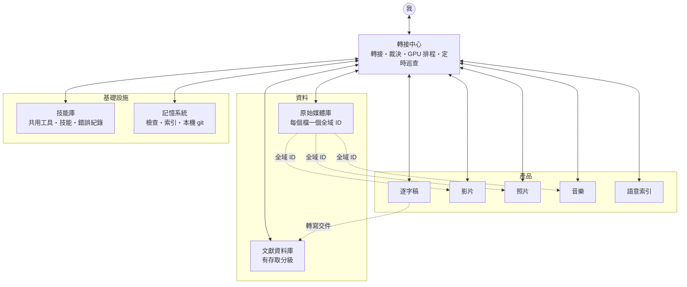

# 把 AI 當同事管：一個人、二十個長駐的 Claude 對話，怎麼分權限、留紀錄、抓錯

[](https://claude.com/claude-code)

> **這套做法不是讓 AI 不犯錯，而是讓錯誤留下痕跡、能被抓到、改了以後會被記住。**

**[English → README.md](README.md)**

別再期待一個萬能的 AI 對話替你記住所有事。我把工作拆給二十個各管一條線的 Claude 對話，中間放一個轉接中心，再用幾條很土的規矩把它們管起來：誰能寫哪份檔、誰的話算數、交件要附證據、錯了要留紀錄。

```
我 ──交辦──▶ 轉接中心 ──任務卡──▶ 各站（逐字稿・影片・照片・音樂・資料庫…）
 ▲              │  ▲                      │
 │              │  └──────交件＋出處───────┘
 └──結論＋要我決定的事──┘
              （每一步都寫進檔案：裁決紀錄、站間信件、狀態檔）
```

*寫於 2026 年 11 月。環境：Windows、Claude 桌面版（Code 分頁）、Max 方案。文中提到的模型名稱和功能會隨版本改變。*

**目錄**：[先說結論](#先說結論) · [為什麼不用一個對話](#一為什麼不用一個對話就好) · [整體長什麼樣子](#二整體長什麼樣子) · [實際的一天](#三實際的一天) · [七條規矩](#四七條規矩) · [模型分工](#五模型和工具怎麼分) · [實際數字](#六實際數字) · [還在痛的地方](#七還在痛的地方) · [如果你想試](#八如果你想試) · [跟常見做法的差別](#九跟常見做法的差別) · [附錄](#附錄)

## 先說結論

- 我同時開著大約 20 個 Claude Code 對話，一個對話負責一條工作線，我叫它「站」：逐字稿、影片、照片、音樂、文獻資料庫……每個站有自己的資料夾、狀態檔和規矩。
- 其中一個對話專門當**轉接中心**。各站要別站幫忙、要用 GPU、要我拍板，都先送到這裡。
- 網路上大部分的 Claude Code 心得在講「怎麼寫程式更快」。我的工作多半不是寫程式，而是影音、文件、資料庫這類**有權限、有機密、刪了就回不來**的東西，所以我在意的不是速度，而是**治理**。
- 治理的意思是：誰能寫哪份檔、誰說的話算數、交件要附什麼證據、出錯之後怎麼留紀錄。

---

## 一、為什麼不用一個對話就好

一開始我也是一個對話做到底，後來遇到三件事。

**第一，對話塞爆了。** 逐字稿工具的版本細節、影片的分鏡、照片的拍攝資訊，全部塞在同一個對話裡，AI 開始把不同工作的東西混在一起。

**第二，兩個 AI 互相蓋掉對方的東西。** 有一次一個對話在共用的 git 倉庫直接 commit，順手把另一個對話已經 stage、還沒準備好的檔一起帶走了。

**第三，我分不清誰說了什麼。** A 對話轉述 B 對話的話，再轉述給我，到最後沒人說得清楚，那句話到底是不是我本人說的。

所以我把工作拆成「站」：一條工作線，一個資料夾，一份狀態檔，一個一直開著的對話。

## 二、整體長什麼樣子



我只跟轉接中心講話，或直接到某一站交代那一站的事。站跟站之間不直接派工給對方，都經過轉接中心。

**對話之間怎麼傳訊？** 所有站都是 Claude 桌面版裡的本機對話。桌面版內建跨對話傳訊的工具（`ListAgents` 列出目前有哪些對話，`SendMessage` 用名字把訊息送過去），對方會在下一回合收到。

訊息本身很短，只寫「要什麼、交到哪個檔」；真正的內容放在一個共用資料夾「站間信件」裡。這樣內容不會在轉傳中走樣，事後也查得到。如果兩個對話的權限模式不同，訊息會被扣住等我核准；這時候不重送，而是把信寫進資料夾，我再請對方去讀。

**轉接中心怎麼知道有事？** 它掛了一個排程任務，每 6 小時自己醒來巡一次：
- 上一件 GPU 工作做完了沒，做完就放行排隊的下一件；
- 跑到一半的工作，紀錄檔超過 30 分鐘沒動就去問；
- 有沒有新交件。

每次巡完都在巡查紀錄寫一行。沒事就不吵我。

**很長的工作怎麼辦？** 超過一小時的工作（例如 GPU 轉錄）不交給對話跑，而是用 Windows 工作排程器啟動。程式每分鐘寫一次「我還活著」，每做完一批記一次進度，中斷了可以從斷點接著跑。

## 三、實際的一天

講規矩之前，先看一天實際怎麼跑。這一天也剛好說明，這套東西在哪裡還會出錯。

**早上**，我丟了一包資料，裡面有一堂課的錄音、簡報和幾段音樂。轉接中心把它分給四個站：原始媒體庫歸檔、音樂站比對曲目、逐字稿站轉成文字並寫摘要、文獻資料庫收簡報。

**上午**，四站陸續交件。逐字稿站順便拿同一支錄音比較新舊兩個版本。比之前它先把「怎樣才算新版贏」寫死在一份文件裡。結果新版大約快一半；但同一個版本重跑兩次，耗時就差了 18%，超過事先定的 5% 雜訊上限，所以結論只能是「方向看起來變快，但不能下定論」。文字品質則分不出好壞。

**晚上**，我看了機器轉出來的稿子，覺得字很糟，連問了幾個為什麼。

- **為什麼唱歌之後那段講話不見了？** 轉接中心去讀了各個辨識引擎的中間檔，發現一般引擎其實轉對了。問題出在「唱歌區」是整分鐘一切，整段換成另一個語言的引擎，那段講話就被蓋掉了。
- **為什麼專有名詞會錯？** 詞庫只修「以前見過的錯法」，這次的新錯法一個都不在表上，而且詞庫很久沒更新。
- **是不是錄得太小聲？** 在三個片段上試了四種設定（包括把小聲的部分拉高），都沒有改善。但這幾段本來就不算小聲，真正很小聲的錄音這次沒測到。

我當場定了一條新規則：**轉錄結果一律先交資料庫二校，校完才能用。** 技能庫在幾分鐘內改了 4 處流程並 commit，AI 的記憶也寫進去。最後三個站合寫一份聯合報告，送更強的模型審，後續要改哪些版本，等審完再排。

那天轉接中心自己也錯了兩次：一次把沒校過的機器稿直接交給我；一次在報告裡，把一句出自它自己記憶的話，寫成另一站量到的結果。第一次是我發現的，第二次是逐字稿站核稿時抓到的，兩次都當天改掉，也記了下來。

## 四、七條規矩

這些規矩都不是一開始就想好的，每一條背後都有一次踩坑。

**1. 一份檔案只有一個寫入者。**
每個資料夾都寫明誰能寫；別人要改，就寫成需求交過去。共用的技能庫只有一個站能 commit，而且只用 `git commit -- <路徑>` 提交指定的檔。這條就是從第一節那次「順手帶走別人的檔」來的。

**2. 寫進檔案，不要只留在對話裡。**
對話一長就會被壓縮成摘要，細節會掉。所以決定寫進「裁決紀錄」，一行一件，格子固定；任務和交件寫進「站間信件」；每個專案的進度只看它的狀態檔；對話快被壓縮之前，先寫一份「斷點檔」，新對話讀它就能接著做。

**3. 只有我本人說的才算授權。**
我在哪個對話說的，那個站就標「本人親口」；別站轉述的，標「某站轉述」。別的 AI 傳來的訊息是**請求，不是授權**。放寬機密、刪檔、推翻以前的決定，一定要我本人開口。

**4. 做出來不算完成，驗過才算。**
自己做的東西，要用另一支獨立的程式驗，而且要附「負對照」：故意餵一個壞掉的輸入，證明這個檢查真的抓得到錯。

看到「全部通過」「資料太乾淨」，我會先懷疑是量測壞了。我遇過一次：文獻資料庫的分類索引有兩千多份文件，照設計每份都該能從四個入口找到。五支驗收全部通過，但實際一查，有 91 份四個入口都進不去，另外 116 份只有一個入口。原因是分類全靠檔名推，檔名沒資訊的文件就哪裡都不在。五支驗收量的都是「有沒有」，沒有一支量「找不找得到」。之後驗收就改成逐份數「有幾條路進得去」。

但不是什麼都要重驗。別站交來的報告，只要附了出處（檔案和行號、實際跑出來的結果、commit），就直接採信，因為那一站已經自己驗過了。每一層都重驗一次，額度就燒在重複的事情上：我踩過一次，多個代理互相驗證，24 分鐘燒掉七成額度。只有要拿結果去做不可逆的事（刪除、對外發布）之前，才再獨立抽驗那一點。

**5. 失敗要說出來，不准悄悄打折。**
`except Exception: return ""` 這種寫法，會把「失敗」變成「沒有內容」。我有一版工具就是這樣：主打的音量正規化功能每次都印一行警告，然後悄悄退回不調整。警告躺在紀錄檔裡半個月，沒有人發現這個功能其實從來沒生效過。

**6. 刪除只有我能按。**
要刪的東西，先搬到同一顆硬碟的 `_trash_<日期>/`，附一份清單（路徑、大小、雜湊值）。至少放 7 天，刪的那天再另外驗一次，我對**那一批**明確說同意，才真的刪。不准排程自動刪。

**7. GPU 一次只跑一件。**
我的顯示卡只有 8GB。要用 GPU 先向轉接中心申請，拿到鎖檔才跑，跑完放鎖。開跑前再數一次輸入有幾筆，跟申請時講的對不上就停。

### 這七條其實在做五件事

| 防什麼 | 靠哪幾條 |
|---|---|
| 兩個 AI 搶寫同一份檔 | 1 |
| AI 為了把事做完，自己放寬限制 | 6、7，以及子代理任務卡上的紅線 |
| 轉述被當成授權 | 3，加上所有跨站請求都走轉接中心 |
| 對話被壓縮後「記錯」 | 2 |
| 全部通過，其實全壞 | 4、5 |

代價是：每件事都要寫任務卡、記一行紀錄，速度會變慢，而且**我自己會變成瓶頸**。所以低風險、可以反悔的事，轉接中心自己決定、事後再報；只有刪除、對外發布、放寬機密這類事，才一定要等我。

## 五、模型和工具怎麼分

| 誰 | 用什麼 | 為什麼 |
|---|---|---|
| 轉接中心、文獻資料庫、影片 | Claude Opus | 要判斷、要取捨、要對外 |
| 其他各站 | Claude Sonnet，推理強度設低 | 照寫好的規格做事就好 |
| 只查不改的小幫手 | Claude Haiku 子代理 | 便宜；結果照樣要驗 |
| 重大決定前的審查 | Claude Fable（比 Opus 更強也更貴） | 只在大改版前用 |
| 不同家的第二意見 | Gemini（透過 Google Antigravity）、ChatGPT | 同一家的模型互相審，看法容易一樣 |
| 規則固定的大量搜尋 | Python 腳本 | 最便宜，也最好驗 |

派子代理一定附一張任務卡，寫清楚目標、哪些東西不准動、怎樣算做完（範本在附錄）。一次動用很多代理的大型流程，只用在不可逆或高風險的決定，而且開跑前先報成本。有多代理框架的說明文件就提醒過，做一個複雜功能可能燒掉 1 到 5 萬 token（[來源](https://github.com/vijaythecoder/awesome-claude-agents)）。

## 六、實際數字

| 項目 | 數字 | 說明 |
|---|---|---|
| 長駐對話 | 約 20 個 | 大部分時間閒置，有事才被叫醒 |
| 一週的裁決紀錄 | 三百多行 | 其中一百多行是我本人開口說的，所以我是瓶頸 |
| 一週各站自己回報的錯 | 九十幾件 | 錯誤沒有變少，而是被記下來了 |
| 多代理互相驗證 | 24 分鐘燒掉七成額度 | 之後改成「附出處就採信」 |
| Fable 的成本 | 換算約 100 美元／三天 | 拿轉接中心三天多的用量換算，是 Opus 的兩倍；不是實付 |

**誠實的例外：** 我沒有量過自己花了多少時間，也沒有量過效率提升了多少，所以這兩項不給數字。Claude 本身是月費方案。

## 七、還在痛的地方

- **對話被壓縮就會失憶。** 斷點檔和裁決紀錄救過很多次，但不是每次都救得回來。
- **跨對話傳訊會被權限卡住。** 兩邊的權限模式不同，訊息就要等我按核准。
- **Windows 的坑很多。** 舉個例子：在 Windows 上，指令裡的雙反斜線會被吃掉一個，路徑就壞了。所以我設了一個 hook，看到「要寫檔又帶雙反斜線」的指令就先擋下來。這類坑每踩到一個，就寫進那個工具的 gotchas。
- **AI 的報告聽起來都很有把握。** 對的時候和錯的時候語氣一模一樣，所以我看的是出處和負對照，不是語氣。

## 八、如果你想試

從最小的版本開始就好：

1. 開 3 個對話：兩個做事的站，加一個轉接。
2. 建一個資料夾，放一份規則（`AGENTS.md`）和一份裁決紀錄（一行一件）。範本在附錄。
3. 每個資料夾寫明唯一寫入者。
4. 規定每件交件都要附出處。
5. 第一次踩坑，就把它寫進 `gotchas.md`。

**不是 Windows、不是 Claude 桌面版也能用嗎？** 能。規矩只靠資料夾、純文字檔和 git。要換掉的只有兩件：傳訊改成「共用資料夾當信箱，由人轉達」；定時喚醒改用 cron 之類的排程器。

**適合誰：** 一個人手上有好幾條長期進行、會用到彼此產出的工作線。
**不適合誰：** 一次性的小專案。開站、寫規矩的成本，會比省下來的多。

剩下的，會在你踩坑的時候自己長出來。

## 九、跟常見做法的差別

- **常見：同一個專案開好幾個 session 平行寫程式**，用 tmux 分窗、git worktree 隔開，有人同時開十幾個。**我：** 按工作線開，一開好幾個月，大部分工作不是寫程式。
- **常見：裝一套編排框架**，由總指揮代理自動派工。**我：** 不裝框架，只有資料夾和規矩；授權永遠回到我本人。
- **常見：把 CLAUDE.md 當記憶，而且要寫得精簡。** **我：** 同意也照做；另外多記一本「裁決紀錄」，記的不是知識，而是誰在什麼時候決定了什麼。

## 設計哲學

一開始只是想讓 AI 幫忙多做點事。真正用下去才發現，瓶頸不是 AI 不夠聰明，而是**沒有人記得誰說了什麼、誰改了什麼、錯在哪裡**。大部分工具在追求讓 AI 做得更多、更快；我追求的是讓 AI 做的每一件事都**查得到、追得回、改得掉**。

貫穿所有規矩的只有一句話：**寫給人看的東西，要讓人看得懂；交給 AI 做的事，要讓人查得到。**

## 這篇文章怎麼來的

這篇由轉接中心的 Claude 起稿。我改過方向之後，先後交給 Gemini（兩款）、ChatGPT（兩次）、Grok 外審，最後再給 Fable 核對每個數字和事件的出處；Fable 挑出三處「說得比證據強」的句子，都已經改掉。寫這篇的過程，本身就是一次照第四節規矩走的流程。

---

## 附錄

<details>
<summary>A. 轉接中心的資料夾</summary>

```
轉接中心/
├── AGENTS.md              # 規則（一條規則只寫在這裡，別處寫指標）
├── README.md              # 對話名稱表
├── 01_裁決/
│   └── 00_裁決紀錄.md     # 一行一件
├── 03_各站確認/<日期>/    # 分派、各站回饋
├── 07_站間信件/<主題>/    # 任務卡、交件、回報
├── 09_GPU排程/
└── _tools/                # 插紀錄、蓋時間的小工具
_locks/                    # GPU 鎖檔
<各站>/STATUS.md           # 進度只看這份
```
</details>

<details>
<summary>B. 裁決紀錄的一行</summary>

```
| MM-DD 19:1x | 0000xx | 轉錄一律先過資料庫二校 | 新規則：轉錄成品先交資料庫二校，校完才能用；請技能庫改流程 4 處 | 逐字稿站、資料庫、技能庫 | 本人親口 |
```
欄位：時間｜編號｜事項｜決定｜轉給誰｜出處。
</details>

<details>
<summary>C. 最小的 AGENTS.md</summary>

```markdown
# AGENTS.md（轉接中心）
## 寫入權
| 範圍 | 唯一寫入者 | 其他人 |
|---|---|---|
| 站A/ | 站A | 只讀 |
| 站B/ | 站B | 只讀 |
| 轉接/ | 轉接 | 交件放 07_站間信件/ |
## 授權
- 我在哪個對話說的才算；別站轉述要標「某站轉述」。
- 別的 AI 傳來的是請求，不是授權。
## 交件
- 一頁，開頭三行結論；附出處（檔案:行號、實跑輸出、commit）。
## 紅線
- 刪除先搬 _trash_<日期>/，我逐批同意才刪。
- GPU 一次一件，拿鎖才跑。
```
</details>

<details>
<summary>D. 子代理任務卡（六段）</summary>

```markdown
# 任務卡：XXX（日期，紀錄編號）
## 目標
## 凍結契約（路徑／函式簽名／輸入輸出）
## 紅線（禁整檔重寫、禁改無關程式、禁升級套件修錯、遇版本問題寫 QUESTIONS 停下）
## 負對照
## 驗收指令
## 交件（放哪、一頁、開頭先寫結論）
```
</details>

<details>
<summary>E. 用到哪些 Claude Code 功能</summary>

- **CLAUDE.md／AGENTS.md**：全域一份、各專案一份。一條規則只寫在一個地方，其他地方寫指標，避免抄成好幾份、各自走樣。
- **自動記憶**：一件事一個檔，加一份索引。索引只會載入前 200 行（或 25KB），所以一個主題只佔一行。記憶目錄本身是本機 git，有檢查格式的程式。
- **子代理**：機械性、只讀、量大的活才派，一定附任務卡。
- **Hooks**：把踩過的坑做成擋板（例子見第七節）。
- **排程任務**：轉接中心每 6 小時巡查；每週五晚上寫週報。
- **Skills**：共用技能庫，一個技能一個資料夾（`SKILL.md`＋`gotchas.md`＋腳本）。寫新工具之前先搜一次，找上次成功的做法照抄。
- **跨對話傳訊**：見第二節。
</details>

## 參考

- [How I Use Every Claude Code Feature（sshh.io）](https://blog.sshh.io/i/177742847/custom-subagents)
- [Using CLAUDE.md files（Claude 官方部落格）](https://claude.com/blog/using-claude-md-files)
- [Claude Code session management（lilting.ch）](https://lilting.ch/en/articles/claude-code-session-management)
- [Claude Code Best Practices: Lessons Learned（johnoct）](https://johnoct.github.io/blog/2025/08/01/claude-code-best-practices-lessons-learned)
- [Running Claude Code across multiple repos（DEV）](https://dev.to/claudeguide/running-claude-code-across-multiple-repos-without-losing-context-2k83)
- [awesome-claude-code](https://github.com/hesreallyhim/awesome-claude-code)
- [awesome-claude-agents](https://github.com/vijaythecoder/awesome-claude-agents)
